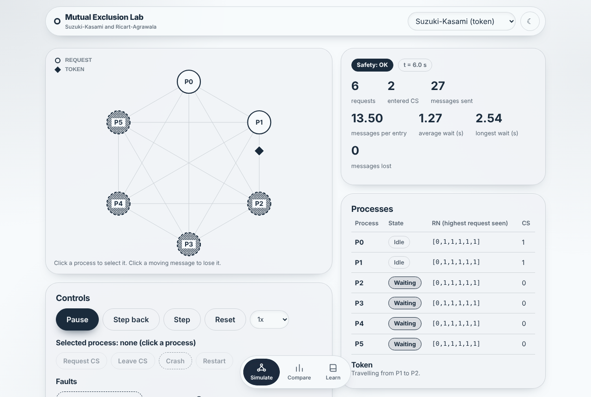
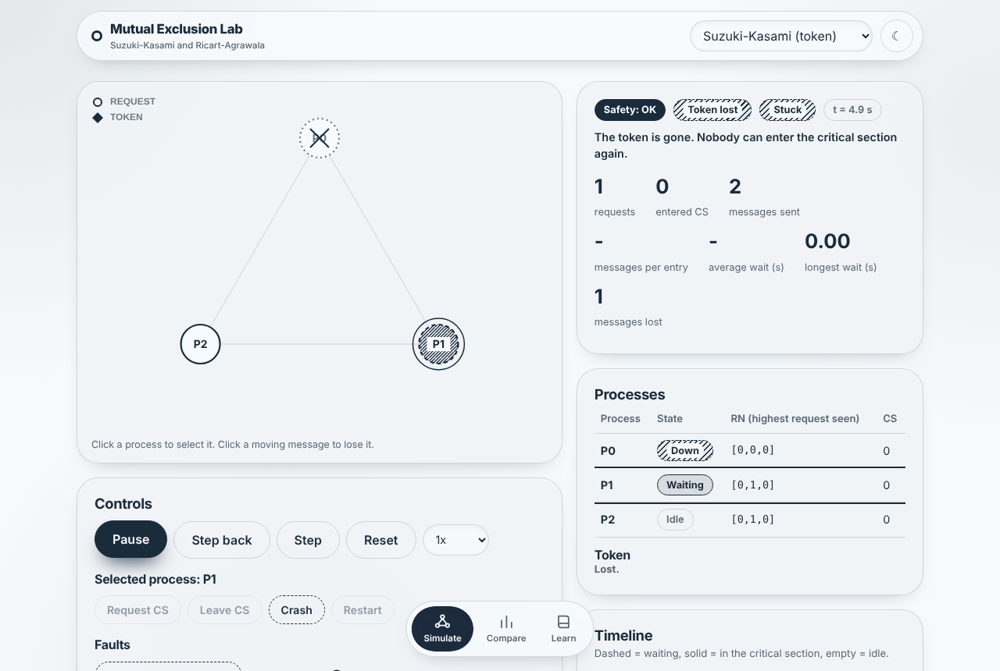
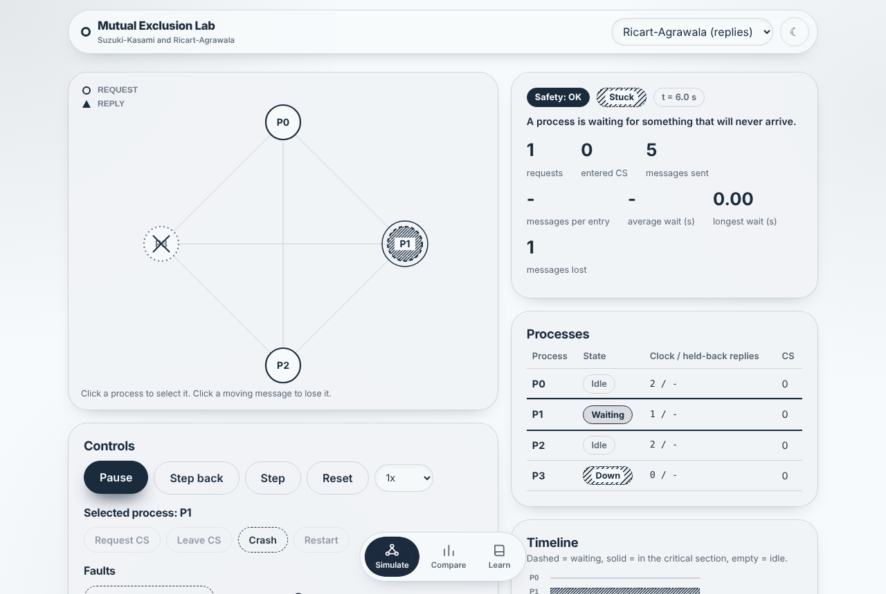
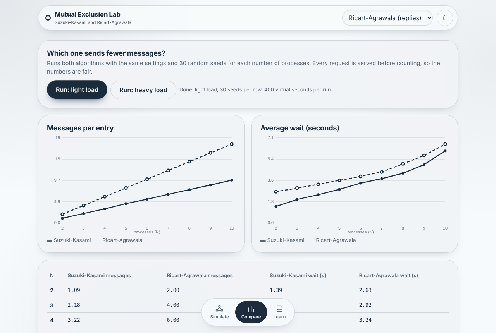
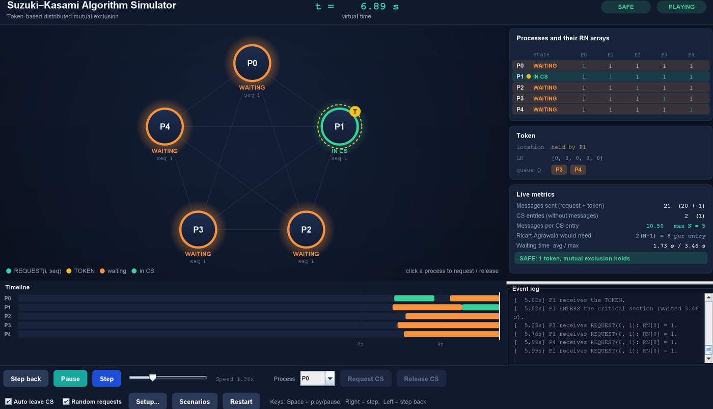

# Suzuki-Kasami Simulator

Simulator that shows how Suzuki-Kasami and Ricart-Agrawala keep processes out of the critical section together, and what breaks them.

- **Status:** finished
- **Built:** September 2026 (Java), November 2026 (web version, faults, comparison)
- **Keywords:** Java, Swing, JavaScript, Distributed Computing, Mutual Exclusion, Suzuki-Kasami, Ricart-Agrawala, Simulation

## Highlights

- Built two versions: a Java Swing desktop app (Suzuki-Kasami) and a plain JavaScript web version that runs in any browser, phone included.
- Web version runs both algorithms for 2 to 10 processes: play, pause, step, step back, with token, RN, queue, timeline and a safety monitor.
- Added fault injection: lose any message (by click, at random, or the next one) and crash or restart a process. The page shows a lost token or a blocked process.
- Added a Compare page: both algorithms, same settings, 30 seeds for each N from 2 to 10. At N = 10 under light load Ricart-Agrawala sends 18 messages per entry and Suzuki-Kasami 9.78.
- Wrote self tests for Java (400 random runs, about 1.2 million events) and JavaScript (240 runs, 168,000 events).

## Screenshots



Simulate: 6 processes, 4 waiting (dashed), the token (diamond) on its way from P1 to P2.



Fault: P0 held the token and crashed. P1 asks for the critical section and waits forever.



Fault: in Ricart-Agrawala one crashed process (P3) is enough to block P1, because it needs a reply from everyone.



Compare: messages per entry and average wait for N = 2 to 10 under light load.



The Java desktop version.

## Tech

- Java 17 or newer, Swing with custom painting, no external libraries.
- Plain HTML, CSS and JavaScript for the web version. Charts and the network are drawn on `<canvas>`.
- One virtual clock drives everything, so the animation cannot drift from the algorithm.
- The algorithms live in `src/skm/engine/Simulation.java` (Java) and `web/engine.js` (web). The windows only draw them.
- Node.js is needed only to run the web tests.

## Run it

- Needs: JDK 17 or newer for the desktop app. A browser for the web version.
- Tested on: JDK 21 on Linux and Windows; Node.js 22; Chromium.

Web version: open `web/index.html` in a browser.

Desktop version, Windows: double-click `run.bat`. Linux or macOS:

```bash
sh run.sh
```

Tests (each one checks safety after every event):

```bash
node web/test.js
javac -d out $(find src -name "*.java")
java -cp out skm.test.EngineSelfTest
java -cp out skm.tools.Benchmark
```

Putting the web version online is in [docs/DEPLOY.md](docs/DEPLOY.md). More detail on the desktop app is in [docs/GUIDE.md](docs/GUIDE.md).

## Limits and next

- Not done: it is a simulation on one computer with a virtual clock, not real processes on a network.
- Not done: no recovery. There are no timeouts and no token regeneration, so the simulator shows the failure and stops there.
- Not done: the Java desktop app runs only Suzuki-Kasami. Ricart-Agrawala is in the web version and in the Java benchmark.
- Not done: at most 10 processes.

## Author

Sachin Kumar | [GitHub](https://github.com/sachinkrcodes) | [LinkedIn](https://www.linkedin.com/in/sachinkrcodes) | Portfolio: [sachinkrcodes.vercel.app](https://sachinkrcodes.vercel.app) | sachinkrcodes@gmail.com

MIT License. See [LICENSE](LICENSE).
