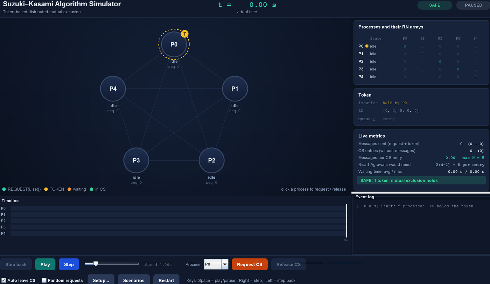
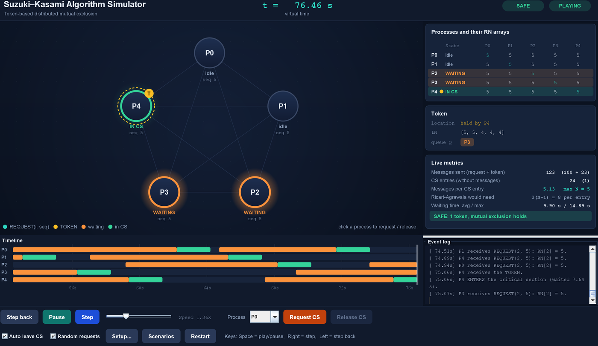

# Suzuki-Kasami Algorithm Simulator

Desktop app that shows how the Suzuki-Kasami token algorithm gives distributed processes mutual exclusion, step by step.

- **Status:** finished
- **Built:** September 2026
- **Keywords:** Java, Swing, Distributed Computing, Mutual Exclusion, Suzuki-Kasami, Simulation

## Highlights

- Built a simulator for 2 to 10 processes. Play, pause, step and step back, with speed from 0.25x to 4x.
- Click a process to make it request or release the critical section, and watch the REQUEST and TOKEN messages travel.
- Added live panels: RN array of every process, the token (LN and queue), event log, timeline, message counts, waiting times and a safety monitor.
- Added Setup (process count, first token holder, seed, delay range, FIFO or non-FIFO channels), 5 ready scenarios, and save and open of your own `.skm` scenario files.
- Added a headless benchmark that compares Suzuki-Kasami with Ricart-Agrawala (30 seeds per row, N = 2 to 10).
- Measured at N = 10: Ricart-Agrawala uses 18 messages per entry, Suzuki-Kasami 9.78 (light load) and 9.95 (heavy load).
- Under light load Suzuki-Kasami also waits less (6.11 s vs 6.82 s at N = 10).
- Wrote a self test: 400 random simulations, about 1.2 million events, checked after every event. It passed with 0 failures.

## Screenshots



Start: 5 processes, all idle, P0 holds the token.


Running: P1 holds the token and is in the critical section, the others wait.



After 76 seconds of virtual time: the timeline shows who waited and when, and the monitor still says SAFE.

## Tech

- Java 17 or newer, no external libraries.
- Swing with custom painting: the network, the timeline and the panels are drawn by hand.
- One virtual clock drives everything. A message's position is computed from the clock every frame, so the animation cannot drift from the algorithm.
- The algorithm lives only in `Simulation.java`. The window only draws it.

## Run it

- Needs: JDK 17 or newer (check with `java -version`)
- Tested on: JDK 21 on Linux (self test passes)

Windows: double-click `run.bat`, or double-click `SuzukiKasami.jar`.

Linux or macOS:

```bash
sh run.sh
```

Self test:

```bash
javac -d out $(find src -name "*.java")
java -cp out skm.test.EngineSelfTest
```

Keys: Space = play or pause, Right = step, Left = step back. More detail is in [docs/GUIDE.md](docs/GUIDE.md).

## Limits and next

- Not done: it is a simulation on one computer with a virtual clock, not real processes on a network.
- Not done: no crashed processes or lost messages. The algorithm assumes none.
- Not done: only the Suzuki-Kasami algorithm. Ricart-Agrawala appears only as a message-count comparison.

## Author

Sachin Kumar | [GitHub](https://github.com/sachinkrcodes) | [LinkedIn](https://www.linkedin.com/in/sachinkrcodes) | Portfolio: [sachinkrcodes.vercel.app](https://sachinkrcodes.vercel.app) | sachinkrcodes@gmail.com

MIT License. See [LICENSE](LICENSE).
